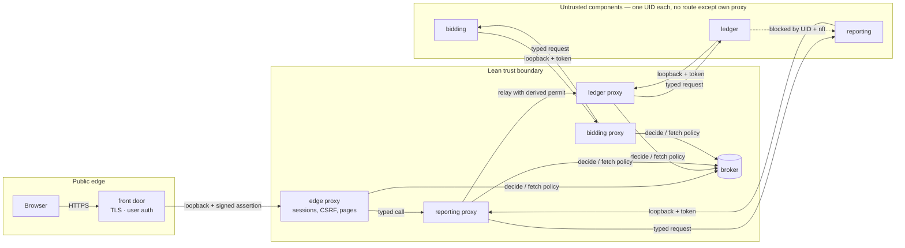
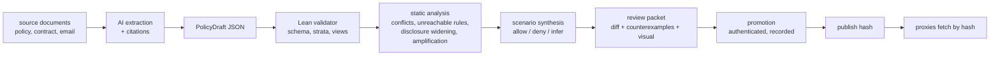
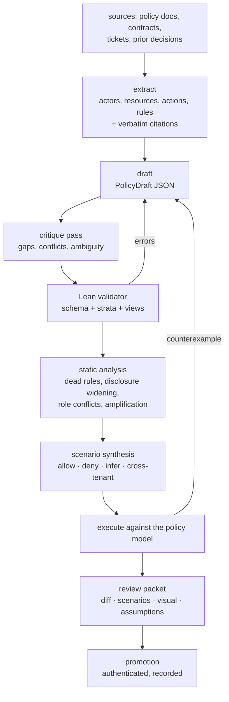

# Zenturian — implementation plan

Status: planning. No code yet.
Target: a permission system in which every inter-component call is mediated by a Lean proxy and
certified by a central broker, with business rules appraised and visualised by AI.

This document is the build plan. It fixes the vocabulary, the trust argument, the Lean data
model, the service topology, the milestone order, and the evidence each milestone must produce.
It is deliberately explicit about what is *proved*, what is *enforced by deployment*, what is
*tested*, and what is *assumed*.

**Contents.** [1. Scope](#1-what-the-system-does) · [2. Architecture](#2-architecture) ·
[3. Policy and certification](#3-policy-model-and-certification) ·
[4. Type discipline](#4-type-discipline-across-languages) · [5. Proxies](#5-proxies) ·
[6. Broker](#6-broker) · [7. Edge](#7-edge-and-the-web-surface) · [8. AI appraisal](#8-ai-appraisal) ·
[9. Visualisation](#9-visualisation) · [10. Reference system](#10-reference-system) ·
[11. Repository and build](#11-repository-toolchain-build) · [12. Milestones](#12-milestones) ·
[13. Verification](#13-verification) · [14. Open source](#14-open-source) ·
[15. Risks](#15-risks-and-open-decisions) · [16. First two weeks](#16-first-two-weeks)

---

## 0. Decision summary

| Question | Decision |
|---|---|
| Where is the boundary? | Every network hop between components terminates in a Lean proxy. Components speak HTTP/JSON to their own proxy only. |
| What does the broker certify? | That a specific call, by a specific component on behalf of a specific principal, is permitted by a specific policy version. The permit carries a machine-checkable derivation. |
| How is the permit bound to the call? | Canonical encoding of the call → SHA-256 digest. Permit contains the digest; the proxy recomputes it from the request it is about to forward. |
| What does Lean actually guarantee? | Checker soundness against the policy semantics; permit/call binding; per-view field disclosure; session sequencing; protocol shapes. Kernel-checked. |
| What is the certification unit? | A manifest: verified proxy/broker templates + policy + topology + keys. Not the running binaries; not arbitrary component code. |
| What is not proved? | That the policy captures the business rule (AI + review), that deployment isolation holds (tested), that a component does not retain or leak data it already received. |
| Policy evaluation engine | Lean; the IR is authored as JSON and compiled to a checkable Lean policy value. |
| AI authority | AI proposes rules, scenarios and explanations; it cannot mint a policy version or a permit. Promotion is a recorded, authenticated action. |
| Transport | Loopback TCP + per-component bearer token + Ed25519-signed permits in v1; Unix sockets with `SO_PEERCRED` once LeanIn exposes them. Both are fail-closed. |
| Single host? | Yes for v1. Remote proxies verify the same signature; multi-host only adds channel isolation. |
| License | Apache-2.0, public repository, DCO contributions, no CLA. |

---

## 1. What the system does

### 1.1 Product statement

Zenturian is a **reference-monitor architecture for business rules**. A business application is
split into components — a reporting service, a payroll ledger, a bidding service — each written in
whatever language suits it. A component holds no network route to any other component.
It reaches the outside world only through a **proxy**: a Lean HTTP service that

1. authenticates the caller,
2. obtains from the **broker** a permit for the exact call,
3. verifies the permit and the protocol shape,
4. applies **view projection** and **row-level invariants** to the response,
5. records the exchange.

The broker owns the policy, certifies decisions, and keeps an append-only audit chain. The
proxies are the only listeners a component can reach, so the Lean type discipline is not advice:
it is the API surface.

### 1.2 Goals

- A permission or disclosure rule stated once is enforced at every hop, including
  component-to-component hops.
- A refused call has no side effect and a machine-readable reason.
- A disclosure rule constrains *what the caller learns*, not only which endpoint it may open.
- Business rules arrive as natural language, are converted to a formal model by AI, and are
  challenged by generated scenarios before they can take effect.
- Every allow/deny is explainable from the audit log alone: policy version, derivation, permit,
  forwarded fields.
- The whole system is reproducible from a pinned Nix flake and auditable as open source.

### 1.3 Non-goals

- Not a general-purpose IAM product, not an SSO implementation.
- Not a sandbox for arbitrary component code. Isolation is per-UID/network policy, not a VM.
- Not a proof that a component does not leak what it has already received. The boundary controls
  what crosses it, not what a recipient does afterwards.
- Not a replacement for a data store's own authorization. Authoritative stores sit behind read
  interfaces whose responses are validated at the proxy.
- Not a proof of policy fidelity. A formal policy can be the wrong rule, faithfully enforced. AI
  appraisal and generated counterexamples reduce that risk; they do not eliminate it.

### 1.4 The motivating failure

A payroll service prepares a report for the Bristol manager. Authentication succeeds, the file
permissions are correct, and the report reaches the right person — containing one Cardiff row
because a filter was omitted. In a second variant the rows are right but the sharing list includes
the Bristol manager.

Both failures are outside an endpoint-level "may call `/report`" check. Zenturian addresses them
at two different places:

- the **extra row** by a `RowInvariant` on the response type, checked by the proxy on every row
  before forwarding;
- the **extra recipient** by making the recipient part of the call digest and the projection: the
  view is built *for* a principal, and the serializer refuses a different one.

The tender example adds the harder case: each field is individually permitted, but
`winningPrice - ownBid = delta` lets a bidder reconstruct a competitor's price. That is modelled
by the **disclosure closure** in §3.4 and is the flagship demonstration.

---

## 2. Architecture

### 2.1 Processes and trust boundaries



The broker holds the policy store, issues permits, and appends the audit chain; it holds no domain
data and has no store credentials.

The single rule: **a component has exactly one reachable HTTP endpoint, its own proxy**. Calls
between components are expressed as calls to the caller's proxy, which relays through the callee's
proxy; the caller never addresses the callee. The relay edge is the one that makes
component-to-component permissions real: the caller's proxy obtains a permit for the callee's
operation under the derived context `(human, on-behalf-of caller)`, and the callee's proxy verifies
it before forwarding.

The broker is deliberately boring: read-only policy mount, append-only audit, small attack surface.
It is the root of trust for decisions, so its compromise is treated as total (§6.3), not mitigated
by cryptography.

LeanIn's listener binds `127.0.0.1` only and refuses any other address, so the edge cannot face the
network directly. A front door (an ingress with TLS and the identity adapter, or an equivalent)
terminates TLS, authenticates the user, and forwards to the edge over loopback with a signed
assertion. Widening the listener is an upstream option, not a v1 dependency.

### 2.2 Request lifecycle

```mermaid
sequenceDiagram
  autonumber
  participant B as Browser
  participant F as Front door
  participant E as Edge proxy
  participant A as reporting proxy
  participant BR as Broker
  participant C as reporting component
  B->>F: POST /reports (TLS, session cookie)
  F->>E: loopback + signed assertion
  E->>E: session, CSRF, resolve principal
  E->>BR: /v1/decide (edge → reporting, canonical call)
  BR->>BR: evaluate policy, emit derivation
  BR-->>E: permit {policyHash, callDigest, derivation, expiry, nonce}
  E->>A: typed call + permit
  A->>A: verify signature, fetch policy by hash, check derivation, digest, session
  A->>C: typed request (only after verification)
  C-->>A: rows
  A->>A: type-check rows, row invariants, project view
  alt invariant or type fails
    A-->>E: 403 with reason; nothing forwarded
  else ok
    A-->>E: projected view + audit id
  end
  E-->>F: rendered page
  F-->>B: rendered page
  Note over A,C: A call from C to another component repeats<br/>decide at A's egress and verify at the callee's proxy.
```

A denied call performs no component invocation: verification precedes the forward. A permit is
single-use and short-lived; a duplicate nonce is refused. The caller never supplies a permit — its
own proxy obtains one for the hop. The second hop (component → component) is the same pattern with
the caller's proxy as the egress and the callee's proxy as the ingress.

### 2.3 What the type discipline does and does not cover

| Layer | Mechanism | What it establishes |
|---|---|---|
| Policy semantics | Lean definitions + kernel-checked theorems | A verified derivation entails `Allows`; no permit verifies for an unpermitted call |
| Permit binding | canonical encoding + digest | A permit for call A cannot be replayed for call B |
| Disclosure | per-view field lists + closure theorem | A forwarded view contains only permitted fields; a numeric field is refused when the recipient can reconstruct a protected value |
| Protocol | Lean inductive component spec + generated clients | Message shapes, sequencing, response types |
| Topology | OS isolation + tests | Components cannot reach each other; if they can, tests fail loudly |

The type system does **not** enforce the topology. That is a deployment property: separate UIDs,
per-component tokens, firewall rules, and a test that attempts the forbidden connections.

The broker and every proxy link the same `Zenturian.Core` library at the same pinned Lean version;
the canonical encoder, derivation checker and view declarations have one implementation. There is no
second, weaker checker in a proxy.

---

## 3. Policy model and certification

### 3.1 Policy IR

The authoring format is JSON; the runtime form is a canonical CBOR value hashed by SHA-256. The
IR is deliberately small: stratified Datalog over finite domains, with a bounded disclosure
fragment.

```lean
-- Zenturian/Core/Policy.lean  (shape; M1 makes it compile)
namespace Zenturian

abbrev PrincipalId := String
abbrev ComponentId := String
abbrev ResourceId  := String
abbrev TenantId    := String
abbrev PolicyHash  := ByteArray

structure Context where
  principal   : PrincipalId
  component   : ComponentId
  onBehalfOf  : Option PrincipalId
  tenant      : TenantId
  attrs       : Std.HashMap String String
deriving Repr

inductive Action where
  | read | list | create | update | delete | invoke (name : String)
deriving DecidableEq, Repr

inductive Effect where | allow | deny | disclose

structure Rule where
  id         : String
  effect     : Effect
  subject    : Term
  action     : Term
  resource   : Term
  guard      : Cond
  disclosure : Option DisclosureClause
  source     : SourceRef          -- document id + span; never omitted
deriving Repr

structure Policy where
  rules    : Array Rule
  strata   : Array (Array Nat)    -- negation only across strata
  views    : Array ViewDecl
  manifest : Manifest             -- hash, version, authors, appraisal run id
```

`Policy` is a *value*, not a program. AI and humans author JSON; the Lean validator turns it into
this structure. The only executable semantics is the rule closure defined once in
`Zenturian.Core.Derive`. `Policy.hash` is SHA-256 over the canonical policy bytes; it is computed,
not stored, so it cannot drift from the content. Auxiliary types (`Term`, `Cond`, `SourceRef`,
`ViewDecl`, `Manifest`) live in the same module and stay deliberately boring: patterns over finite
domains, no evaluation, no reflection.

Allow rules derive `permit`; deny rules derive `blocked` in a later stratum. `Allows` is the
conjunction with the absence of a block:

```lean
def Allows (p : Policy) (call : Call) : Prop :=
  Derives p (.permit call) ∧ ¬ Derives p (.blocked call)
```

The negated premise is why denial soundness requires completeness: a procedure that cannot decide
returns `escalate` rather than asserting the absence of a derivation it did not search.

### 3.2 Decisions and permits

```lean
-- Zenturian/Core/Cert.lean
inductive Verdict where
  | allow    (d : DerivationData)
  | deny     (reason : DenialReason)
  | escalate (reason : String)      -- outside the decided fragment; fail closed

structure Permit where
  policyHash : PolicyHash
  callDigest : ByteArray
  principal  : PrincipalId
  component  : ComponentId
  onBehalfOf : Option PrincipalId
  issuedAt   : Nat
  expiresAt  : Nat
  nonce      : ByteArray
  derivation : DerivationData
  tag        : ByteArray            -- Ed25519 sig by the broker over the canonical body, minus this field

/-- The proxy runs this, not `Allows`; it needs the policy, the broker's public key and the bytes. -/
def verify (brokerKey : PubKey) (pol : Policy) (p : Permit) (call : Call) (now : Nat) : Bool :=
  sigValid brokerKey p
  && p.policyHash == pol.hash
  && p.callDigest == canonicalDigest call
  && p.principal == call.ctx.principal
  && p.component == call.ctx.component
  && p.onBehalfOf == call.ctx.onBehalfOf
  && p.derivation.root == permitAtom call
  && p.issuedAt ≤ now && now ≤ p.expiresAt
  && check pol p.derivation

theorem verify_sound
    (h : verify brokerKey pol p call now = true) :
    Allows pol call := ...

theorem decide_allow_sound :
    (decide pol call now).verdict = .allow d → Allows pol call := ...

theorem decide_deny_sound :
    (decide pol call now).verdict = .deny r → ¬ Allows pol call := ...
```

A proof term cannot cross a process boundary. `Derivation` is the inductive proposition the
theorems are about; `DerivationData` is a finite, serializable tree; `check : Policy →
DerivationData → Bool` is their bridge, and `check_sound` is the central theorem. The broker emits
data, the proxy checks data, and the theorems relate that data to `Allows`. `derivation.root`
records the atom being proved, so a derivation for a different call cannot be re-labelled. The
digest covers the whole context, including tenant and the stable attributes the policy reads; the
explicit field comparisons in `verify` exist for a precise failure, not as the binding.

A proxy checks the derivation instead of trusting a verdict: a forged permit, a corrupted one, or a
broker bug fails at the proxy. The permit's Ed25519 signature authenticates the broker and is
checked before the derivation; it is not part of `Allows`. The broker holds the private key and
the proxies hold only the public key, so a compromised proxy cannot mint a permit for another proxy.
A malicious broker can still certify a bad policy; that is the root-of-trust assumption (§13.5),
not something verification removes. `verify` is the total predicate; the proxy runs the signature
check first, so it never fetches policy bytes named by an unauthenticated permit.

`decide_deny_sound` holds only for the complete fragment. The decision procedure therefore
returns `escalate` — never `deny` — when it meets a construct it cannot decide: non-linear
disclosure arithmetic, a delegation chain beyond the configured depth, an unbounded quantifier.
Escalation is refused at the proxy (fail closed) and queued for review. A near-miss must not
become a plausible-looking "deny" that the audit then presents as proof of absence.

Replay is operational, not semantic: the proxy keeps a bounded set of seen nonces until expiry and
refuses duplicates. This is not part of `Allows`, and the guarantee is stated as "a duplicate
permit is refused by a live proxy" — a tested property, not a theorem.

The global claim, deployment model, certifier and trusted computing base are specified in
[docs/theorem.md](docs/theorem.md). The theorem is about a certified deployment of verified
templates, not about the running binaries.

Permits are short-lived: 30 s by default, 5 s for `disclose`-effect operations. Revocation in v1 is
expiry plus a policy-version bump; there is no revocation list. The TTL is the retirement bound: a
policy change takes effect within one TTL. A proxy that cannot obtain the policy behind a permit's
hash refuses the call.

### 3.3 What a permit binds

`Call` embeds its `Context` (principal, component, on-behalf-of chain, tenant, stable attributes)
plus the operation, the resource, and the arguments as a `CanonValue` parsed from JSON.

The canonical encoding is our own length-prefixed binary form, not JSON text: definite lengths,
sorted keys, no floats (numbers are `Rat` serialized as `num/den`), no duplicate keys. Injectivity is
proved structurally:

```lean
def canonical : Call → ByteArray

theorem canonical_injective :
    canonical a = canonical b → a = b
```

The digest is SHA-256 of the canonical bytes. This adds one assumption — SHA-256 collision
resistance — and removes the cross-language canonicalization bug class: components never compute
the digest. They send JSON; the proxy parses, canonicalizes and checks. Generated clients may
compute digests for local assertions, but the proxy's value is authoritative.

### 3.4 Disclosure: what the caller can learn

Access control answers "may this principal call this operation". It does not answer "what may this
response reveal". Zenturian models the second question for a declared fragment and refuses to
pretend outside it.

Every response crosses as a **view**, a named structure whose fields are the permitted ones:

```lean
-- Zenturian/Core/View.lean
structure TenderFeedbackView where
  ownBid        : Money
  scheduleScore : Score
  comments      : Array Comment       -- length- and charset-bounded
  -- winningPrice, delta, otherBids: absent by construction

def projectTenderFeedback
    (ctx : Context) (bid : Bid) (award : Award) : Option TenderFeedbackView
```

Each view declares its label and a disclosure obligation:

```lean
structure ViewDecl where
  name    : String
  fields  : Array FieldId
  label   : Label                 -- principal + purpose + via-component chain
  permitted : Array FactPattern   -- what the policy allows this label to know
  source  : SourceRef
```

For numeric fields, the policy may add a **closure check**. The fact algebra is deliberately
small:

```lean
inductive Fact where
  | known      (v : VarId) (value : Rat)   -- the recipient already holds it
  | disclosed  (v : VarId) (value : Rat)
  | equation   (lhs rhs : LinearExpr)      -- true in the world and disclosed
  | identifier (e : EntityId)
```

`closure` computes the rational affine span of the disclosed equations and known values.
`Reveals facts secret` holds when `secret`'s variable is in that span. In the tender case:

- disclosed: `ownBid` (the bidder's own submission), `delta = winningPrice - ownBid`;
- known: `ownBid`;
- therefore `winningPrice = ownBid + delta` is in the closure → the disclosure is refused.

The validator rejects any declared view whose fields, together with the recipient's declared prior
knowledge, put a protected value in the closure; the runtime repeats the check before sending, so a
projector bug does not become a disclosure. Non-linear constructs — percentages of a total, averages,
rank-dependent facts — are outside the fragment. A view that needs one must be marked `unmodelled`
with a written justification; those views are refused by default and require an explicit policy
flag plus review. This is the honest boundary: "what a recipient can infer from world knowledge"
is not decidable; "what a recipient can infer from the facts we declared" is.

**Attenuation across hops.** A component calling on behalf of a human must not see more than the
human. For every view used on a `via = A` hop, the validator checks
`fields(view via A) ⊆ fields(view for the human)` and the runtime re-checks the closure under the
relayed label `(human, on-behalf-of A)`. Field-set inclusion is necessary, not sufficient: the
closure check, not the inclusion check, is what refuses a value the human could not have inferred.
A separate service grant is the only way to name extra fields, and it is visible in the review
diff.

### 3.5 Policy lifecycle



Rules that never change without a new hash:

- accepted policy bytes are immutable; changing one rule produces a new version;
- a permit names the version it was issued under;
- rollback is re-promotion of an older hash, recorded as a new event;
- the review packet and the appraisal run are stored beside the version.

---

## 4. Type discipline across languages

### 4.1 Component specification

Each component has one Lean module describing its surface. The proxy is generated from it; the
clients are generated from it; the policy references its operations.

```lean
-- Zenturian/Components/Ledger.lean
inductive Op where
  | rows   (shop : ShopId) (period : Period)
  | entry  (e : EntryDraft)
  | post   (batch : BatchId)
deriving DecidableEq, Repr

inductive Req : Op → Type where
  | rows  : (shop : ShopId) → (period : Period) → Req (.rows shop period)
  | entry : (e : EntryDraft) → Req (.entry e)
  | post  : (b : BatchId) → Req (.post b)

inductive Resp : (op : Op) → Type where
  | rows  : (shop : ShopId) → (period : Period) → (rows : Array LedgerRow) →
            Resp (.rows shop period)
  | entry : (e : EntryDraft) → (id : EntryId) → Resp (.entry e)
  | post  : (b : BatchId) → (n : Nat) → Resp (.post b)

structure Spec where
  name     : ComponentId
  Op       : Type
  Req      : Op → Type
  Resp     : Op → Type
  decode   : String → Lean.Json → Except String (Σ op, Req op)
  encode   : (op : Op) → Resp op → Lean.Json
  handle   : (op : Op) → Req op → ProxyM (Resp op)   -- in-process services only
  views    : (op : Op) → ViewPlan op
  invariants : (op : Op) → Array (ResponseInvariant op)
```

`decode` is the only place a wire message becomes a typed request. A malformed message, an unknown
operation, or a wrong-arity payload is refused before certification, with a uniform error body.
`handle` is for a service implemented inside the Lean process; a remote component implements the
same operation contract over the wire, and the proxy never calls `handle` to bypass the forward.

### 4.2 Views and row invariants

Two enforcement mechanisms, both at the proxy, both before bytes leave:

1. **Projection.** The proxy never serializes a domain record. Domain types derive `FromJson` (to
   parse what a component sends) and no `ToJson`; only views derive `ToJson`, and a view is
   constructible only through its projector. A domain value therefore has no serializer on the
   wire path. This is structural rather than a lint; a hand-written instance remains a review
   matter. Views are declared with a `view%` macro that emits the structure, its `ToJson`, and its
   `ViewDecl` from one field list, so the fields the validator checks and the fields the serializer
   emits cannot drift.

2. **Invariants.** A response may carry rows. Each row is checked against a declared predicate
   before forwarding:

```lean
structure ResponseInvariant (op : Op) where
  name  : String
  check : Resp op → Bool
  -- e.g. `rows.all (λ r => r.shop == requestedShop)`
```

A single failing row refuses the entire response (`403`, reason `row_invariant`), and the audit
records the invariant name and row index — not the row.

This is what catches the omitted-filter bug. It does not stop a component encoding a salary in a
free comment: that is why free-text fields are bounded and policy-controlled, and why the
limitation is stated rather than papered over.

### 4.3 Sessions

The proxy holds a state machine per `(component, instanceId)`:

```lean
inductive Phase where
  | anonymous
  | open (human : PrincipalId) (purpose : Purpose)
  | reporting (human : PrincipalId) (report : ReportId)

def step : Phase → Op → Except ProtocolError Phase
```

Out-of-order calls are refused with `409` and a reason. Session open is an explicit handshake that
returns an instance id and expiry; generated clients do it once and reuse it. The machine is
per-component, so a restart loses state and the component re-handshakes; there is no silent
recovery.

### 4.4 Generated clients

`zenturian codegen` reads the compiled component specs and emits:

- JSON Schema for every request/response/view (for component developers and CI);
- TypeScript/Zod, Python (msgspec), and Rust (serde) client stubs;
- an operation catalogue for the policy tooling.

Generated files are committed under `clients/<language>/`, with a CI drift check
(`zenturian codegen --check`). The goal is a typed boundary in every language, not a shared
runtime: each client is thin, validates nothing the proxy will validate again, and maps errors
faithfully. A component that ignores its generated client is still constrained by the proxy's
parser and views; the client types are developer convenience, not the guarantee.

### 4.5 Errors and fail-closed

One error envelope: `{ code, reason, auditId }`. Codes are enumerated (`denied`, `escalated`,
`replayed`, `expired`, `policy_unknown`, `protocol`, `invariant`, `unavailable`). Internal detail
never crosses: a denial does not reveal which rule matched or whether the resource exists, except
in an operator-only trace keyed by `auditId`.

### 4.6 Rule families

The point of the system is that the same discipline covers the rule families that make real
permission systems hard. Each family has one model and one enforcement point; nothing is a bolted-on
middleware.

| Family | Example | Model | Enforced by |
|---|---|---|---|
| Access | a buyer may read their own tender | subject/action/resource + guard | broker, every hop |
| Segregation of duties | the approver is not the requester | `blocked` rules over assignment facts, later stratum | broker; static analysis reports conflicts |
| Delegation | act for a colleague until Friday | `onBehalfOf` chain + expiry | broker; depth cap; attenuation per hop |
| Row scope | a Bristol report carries Bristol rows only | response invariant | proxy, before forwarding |
| Field disclosure | feedback omits the winning price | view field set | proxy projector; validator |
| Inference | a price delta reveals the winner's price | closure over declared facts | validator + proxy |
| State precondition | payment requires an approved invoice | session phase + resource fact | proxy + broker |
| Four-eyes | the second approver differs from the first | audit facts in context | broker |
| Quota | at most 100 reads per hour | counter with a policy-named bound | proxy |
| Tenant isolation | no row from another tenant | tenant in context, digest and invariant | broker + proxy |
| Purpose | payroll data not used for marketing | label in the view declaration | proxy |

A family outside this list is not a configuration flag away. Adding one means defining its
semantics, its enforcement point and its proof obligation; until then it is `escalate`, and
`escalate` refuses.

---

## 5. Proxies

### 5.1 Responsibilities

A proxy is a LeanIO native server with a fixed pipeline:

```
admission → parse → certify → verify → session step → forward → validate → project → audit
```

Any failure before `forward` means the component saw nothing. Any failure after `forward` means the
response is discarded and the caller gets an error; the component's side effect, if any, is already
recorded in the audit as "invoked, response rejected", which is a real and visible state. Mutating
operations therefore require idempotency keys, and the proxy records them.

### 5.2 Admission

v1: each proxy listens on `127.0.0.1:<port>`. The shared secret is a 32-byte token provisioned by
systemd as a credential to the proxy and its component only (source
`/run/zenturian/<component>.token`, root-owned, mode `0400`); each service reads it from
`$CREDENTIALS_DIRECTORY`. Neither can read another component's credential; the compose example
mounts the same secret read-only under the unit's UID. The proxy compares it in constant time and
binds the resulting session to the component name compiled into the binary — a token for `ledger`
is not accepted by the `reporting` proxy.

The broker's Ed25519 signing key is held only by the broker; each proxy receives the public key
through its credential and verifies a permit's signature before its derivation. Components receive
neither. A release build requires the libsodium verifier; the test double is compiled only under the
test flag and is refused in a production configuration.

v2 (tracked with LeanIn): Unix domain sockets with `SO_PEERCRED`. LeanIn's `Listener.bind` is
loopback-TCP only today and LeanIO's `serve` takes a port; the plan is to contribute
`Listener.bindUnix` plus a peer-credential accessor, and a LeanIO `serveWithListener`. Until then
the token is the control and the UDS work is an explicit dependency, not an assumption.

Defence in depth: each component runs under its own UID in its own cgroup; nftables rules restrict
each UID to its proxy's port; each proxy's egress is limited to its own component, the broker, and —
when relaying — the callee's proxy. The edge's egress is the set of component proxies it serves. A
component attempting another proxy's port is refused, and a test asserts it.

### 5.3 Verification order and cost

Order matters for both safety and information leak:

1. size and content-type limits (413/415 before parsing),
2. parse to `Σ op, Req op` (no side effects),
3. request a decision for the canonical call; a deny or escalation stops here, before any forward,
4. verify the permit's signature, expiry and nonce (no policy needed); a bad signature stops here,
5. fetch/pin the policy by the now-authenticated hash (cache; miss → fetch once, verify the bytes
   hash),
6. check the derivation and the context binding against the policy,
7. session transition,
8. forward,
9. validate response type and invariants,
10. project view,
11. audit, then respond.

Steps 3–6 are the proxy's own: the component never supplies or sees a permit. The permit is for the
hop the proxy is about to make, and its digest covers that exact canonical call.

The policy value and derivations are bounded in size (rule count, derivation depth); an oversized
permit is refused. Derivations are checked with the same `check` function that appears in
`check_sound`; there is no fast path in a second implementation.

### 5.4 Limits and failure modes

- Request/response cap: 1 MiB, enforced before and during parse. LeanIO's native `readAll`
  accumulates without a `maxBody` bound (documented in its fork notes), so the proxy wraps the
  reader with a counting cap and answers `413` itself. This is a mandatory wrapper, not a caller
  responsibility.
- Header and JSON depth caps; no `readAll` on any path that is not capped.
- Timeouts: 2 s to the broker, 5 s to the component, 10 s total; cancellation propagates.
- Broker unreachable: new calls fail with `unavailable`; permits already verified in flight are
  not honoured beyond their expiry. Fail closed.
- Proxy crash: the component loses access; no fallback listener exists. systemd restarts the proxy,
  which re-fetches policy and starts a new session epoch.
- Component crash: the proxy answers `502` with an audit id; the session is closed.
- Disk full: audit write failure refuses the call (`audit_unavailable`). The audit is part of the
  safety story, not a best-effort log.

### 5.5 Isolation summary

| Asset | Control |
|---|---|
| Component → own proxy | UID + token + loopback port |
| Component → other proxy | nftables by UID; test asserts refusal |
| Component → internet | no route in its netns/cgroup |
| Proxy → broker | loopback port + token; later UDS peer creds |
| Broker → domain data | none; read-only policy mount |
| Browser → edge | TLS and user authentication terminate at the front door; the edge binds loopback |

---

## 6. Broker

### 6.1 API

The broker is a LeanIO native server with one router, on the same backend as the proxies; there is
no second server stack in the trust boundary.

| Route | Purpose |
|---|---|
| `POST /v1/decide` | canonical call + context → permit, denial, or escalation |
| `GET /v1/policy/{hash}` | content-addressed policy bytes; the hash verifies the bytes |
| `POST /v1/promote` | authenticated policy promotion; returns the new hash and review packet id |
| `GET /v1/audit/{id}` | operator trace for one permit (rule path, redacted arguments) |
| `GET /v1/health` | liveness only; no policy detail |

The broker authenticates each proxy by its token, maps it to a component name, and refuses a
decision request whose context names a different component or whose on-behalf-of chain is
malformed. A proxy cannot borrow another component's identity.

`decide` is the only hot path. It is pure apart from the audit append and the nonce-independent
issue counter: policy evaluation is a function of the policy value and the canonical call.

### 6.2 Policy store and audit

- Policy bytes are stored by hash; the "current" pointer is a separate small record.
- `decide` issues only under the current policy, plus a bounded grace window for calls already in
  flight; it never accepts a policy hash chosen by the caller. Retained versions are served only for
  verifying permits already issued.
- The audit chain is `seq, prevHash, ts, actor, callDigest, policyHash, verdict, permitId, reason`.
  `zenturian audit verify` recomputes the chain and reports the first break.
- Payload arguments are not logged by default. The demo build may enable a redacted capture mode;
  the production default is digests only.
- The broker logs every permit it issues. Proxies log every forward and rejection with the permit
  id, so the two logs correlate without trusting the proxy's narrative.

### 6.3 Root of trust

The broker can mint a permit for anything. Its protection is therefore process-level: separate
UID, no domain credentials, read-only policy, audit on an append-only mount, network access limited
to proxies. Compromise of the broker is a total compromise of authorization — that assumption is
recorded, not mitigated by cryptography. A future split (decision service + signer with an HSM)
is out of scope for v1 and noted as a design option.

---

## 7. Edge and the web surface

### 7.1 What the edge does

The edge is a LeanIO server and a proxy in its own right. It manages browser sessions, resolves a
human principal, enforces CSRF and rate limits, and forwards typed calls to component proxies. It
contains no business logic and no direct data access.

It listens on loopback only (LeanIn's listener restriction); the front door (§2.1) terminates TLS
and forwards the authenticated request. A configuration that asks the edge for a non-loopback bind
fails loudly at startup rather than silently binding loopback.

Static assets and server-rendered pages come from the edge; the browser never talks to a component
proxy.

### 7.2 Identity

Two modes, both explicit:

- **Development / demo:** a seeded identity service issues Ed25519 assertions for named test users.
  It is compiled behind a `dev-idp` flag, refuses to start unless `ZENTURIAN_ENV=dev`, and is
  covered by a test that asserts refusal in production mode.
- **Deployment:** a front door (an existing IdP adapter or reverse proxy) authenticates the user and
  signs an assertion with Ed25519 over `{sub, tenant, roles, iat, exp, nonce}`. The edge pins the
  public key and verifies it with the same libsodium binding used elsewhere. The front door is part
  of the authentication boundary, not the authorization boundary: the edge still derives every
  permission from the broker.

No password hashing, JWT algorithm agility, or key management is invented in Lean. The rejected
alternative — parsing OIDC/JWKS and verifying RS256 in Lean — adds crypto surface for no benefit in
v1.

### 7.3 Session and CSRF

- Session cookie: `HttpOnly`, `Secure`, `SameSite=Lax`, random 256-bit id, server-side record with
  idle and absolute expiry.
- CSRF: double-submit token bound to the session; state-changing routes require it.
- Login, logout, and session fixation rotation are tested.
- Denials render a page with the audit id; they never enumerate rules.

---

## 8. AI appraisal

### 8.1 Authority and contract

AI is the analyst, not the authority. It may read source documents, propose a draft policy, propose
scenarios, critique its own draft, and write explanations. It may not:

- write a policy version directly;
- issue or influence a permit at runtime;
- change a view's field list without producing a diff that passes validation;
- suppress a failed scenario.

Runtime never calls a model. Appraisal is an offline pipeline whose outputs are artifacts; the Lean
validator and the promotion step are the only paths into the policy store. This keeps the
runtime's trust surface free of network calls and nondeterminism, and makes every decision
reproducible from stored bytes.

### 8.2 Pipeline



Stages are separate commands with stored inputs/outputs:

```
zenturian-appraise extract  --sources docs/ --out runs/<id>/extraction.json
zenturian-appraise draft    --extraction runs/<id>/extraction.json --out runs/<id>/draft.json
zenturian-appraise critique --draft runs/<id>/draft.json --out runs/<id>/critique.json
zenturian policy compile    --draft runs/<id>/draft.json --out runs/<id>/policy.cbor
zenturian-appraise attack   --policy runs/<id>/policy.cbor --out runs/<id>/scenarios.json
zenturian policy analyse    --policy runs/<id>/policy.cbor --out runs/<id>/analysis.json
zenturian policy promote    --policy runs/<id>/policy.cbor --evidence runs/<id>/evidence.json
```

`zenturian-appraise` is a dev-time tool (Python, `uv`-locked). The `zenturian policy` subcommand is
the Lean binary, so compilation, analysis and promotion share the runtime's definitions. The split
is deliberate: model orchestration is not in the trust boundary; semantics are.

### 8.3 Artifacts

| Artifact | Schema | Consumer |
|---|---|---|
| `extraction.json` | actors, resources, actions, rules, each with `source {doc, span, quote}` | draft, review |
| `draft.json` | `PolicyDraft` | Lean validator |
| `critique.json` | findings with severity and citation | review |
| `policy.cbor` | canonical accepted policy | broker, proxies |
| `scenarios.json` | executable scenarios with expected outcomes | test runner |
| `evidence.json` | hashes of all inputs, model id, prompt hashes, seeds | promotion record |
| `narration/*.md` | generated prose for visualisations | UI build |

The pipeline rejects a rule whose citation does not resolve to a quoted span in the supplied
sources, and the Lean validator rejects a draft with a missing citation. Ambiguity is not silently
resolved: the draft carries `open_questions[]`, and a promotion with unresolved questions requires
an explicit acknowledgement recorded in `evidence.json`.

### 8.4 Model policy

- Provider interface with three backends: local (vLLM/Ollama), hosted (opt-in), and a deterministic
  `replay` backend that re-serves recorded outputs for CI.
- Default for the public demo and for CI is local or replay; hosted calls are opt-in and their
  provider/model/version are recorded.
- Temperature 0 where supported; otherwise best-of-n with a recorded seed and a selection rule.
- Prompts live in the repository, versioned; a prompt change is a code change with its own diff.
- No source document leaves the deployment unless the operator enables a remote backend.

### 8.5 Evaluation

A labelled corpus, checked in:

- the payroll and tender briefs, with hand-written expected rules, views and scenarios;
- a procurement policy with segregation-of-duties rules;
- a multi-tenant SaaS policy with a deliberate cross-tenant leak;
- two documents with genuine ambiguity, to test refusal rather than invention.

Metrics, reported per run and never collapsed into one "accuracy":

| Metric | Target for v1 |
|---|---|
| schema-valid drafts | 100% (gate) |
| rule recall on hand-labelled rules | ≥ 0.85 |
| rule precision | ≥ 0.85 |
| citation resolves to a supporting span | 100% for accepted rules (gate) |
| seeded policy defects found by static analysis + scenarios | ≥ 0.9 |
| disclosure-leak scenarios refused | 100% on the modelled fragment (gate) |
| unmodelled constructs flagged | 100% (gate) |

The gates are gates, the rates are targets. A single run is not a compliance claim; the report
states the model, the corpus, and the run id.

### 8.6 Failure handling

- Model unavailable: the pipeline stops; no draft is produced.
- Schema invalid: bounded repair loop, then stop with the validator errors.
- Contradictory sources: the draft records both rules and a conflict finding; promotion requires a
  decision.
- A scenario that the policy cannot satisfy: the counterexample is attached; promotion blocked
  unless the scenario is explicitly marked wrong, with a reason, by a human.

---

## 9. Visualisation

The visualisation is generated from the policy value and the audit chain, never from prose. AI
writes narration around deterministic data; it cannot supply a number, an edge, or a decision that
the IR does not contain.

| View | Data source | What it answers |
|---|---|---|
| Actor–resource graph | `Policy.rules`, `views` | who can act on what, under which conditions |
| Rule table with citations | rules + source refs | why each rule exists, and where it came from |
| Disclosure lattice | view field sets + closure results | what each principal/label may learn |
| Decision trace | audit + permit derivation | why this call was allowed, denied, or escalated |
| Effective-permission diff | enumeration over a bounded context set | what changed between two policy versions |
| Coverage report | context enumeration vs rules | which rule/context combinations were exercised |

The decision trace is the operational centrepiece: given an audit id, it reconstructs the derivation
tree, the permit, the projected fields, and the forwarded row count, and highlights the first
refusal when one occurred. "Why did the Bristol manager see a Cardiff salary?" is answered by
picking the disclosure event and walking back to the view and the rule that admitted it.

The effective-permission diff enumerates a bounded product (principals × actions × resources ×
tenants) and reports changed verdicts and changed field sets. The bounds and the uncovered
fraction are displayed; a diff that covers 12% of contexts says so.

All visualisation routes live on the edge, read from a materialized snapshot, and require an
operator principal. Generated HTML is served as static files; no browser-side policy evaluation.

---

## 10. Reference system

Two domains, one deployment, used by every milestone demo:

**Procurement.** Components: `directory` (suppliers and buyers, Python), `bidding` (submissions and
awards, Rust), `reporting` (comparison sheets and feedback, TypeScript). The edge (Lean/LeanIO)
renders the pages; the browser never reaches a component. Rules: bidders see only their own bid;
feedback must not reveal the winning price or any value from which it is derivable; buyers see all
bids for their tender; award requires segregation of duties.

**Payroll.** Components: `directory` (employees, shops, managers, Python), `ledger` (payroll rows,
Rust), `reporting` (report composition, TypeScript). Rules: a manager sees rows only for a shop
they manage; a report's recipient must be that shop's current manager; a report's row set must
match its named shop; cross-tenant rows are refused.

The demo has three browser flows: an allowed report, a denied cross-shop report, and a refused
tender feedback that would have leaked the winning price. Each flow has a black-box scenario and a
trace page.

---

## 11. Repository, toolchain, build

### 11.1 Layout

```
zenturian/
  lakefile.lean              -- package `zenturian`, deps leanin + leanio pinned
  lean-toolchain             -- leanprover/lean4:v4.35.0
  flake.nix                  -- Lean tarball pinned by hash; uv, node, python, libsodium
  flake.lock
  Zenturian.lean
  Zenturian/
    Core/        Policy, Derive, Cert, Canonical, View, Disclosure, Session
    Components/  Directory, Ledger, Reporting, Bidding
    Proxy/       Runtime, Admission, Pipeline, Limits, AuditClient
    Broker/      Server, Store, Audit
    Edge/        Server, Session, Identity, Render
    Proofs/      Deployment, Monitor, Relay, Disclosure
    Certify/     Manifest, Valid, Certificate, Main
    Codegen/     Schema, TS, Python, Rust
    App/         Main (subcommands: broker, proxy, edge, policy, certify, audit, codegen)
  clients/       generated; committed; drift-checked
  appraisal/      Python pipeline, prompts, schemas, corpus, runs/ (gitignored)
  viz/           static build from IR + audit
  deploy/        NixOS module, systemd units, nftables, front-door config, compose example
  tests/
    scenarios/    black-box at public sockets
    hostile/      adversarial components
    proofs/       theorem regression (no `sorry`)
  docs/
    theorem.md, threat-model.md, guarantees.md, policy-authoring.md, operations.md
  examples/briefs/   the payroll and tender briefs
  PLAN.md
  LICENSE  NOTICE  README.md  CONTRIBUTING.md  SECURITY.md
  CODE_OF_CONDUCT.md  GOVERNANCE.md  CHANGELOG.md
```

### 11.2 Pins

- Lean `v4.35.0`, matching LeanIn/LeanIO.
- `leanin` (<https://github.com/scidonia/leanin>) and `leanio`
  (<https://github.com/scidonia/leanio>) by commit in `lakefile.lean`, with the commit recorded in
  the milestone notes; both are tracked by hash in the release SBOM.
- Python via `uv` and `pyproject.toml`; Node via `package.json` + lockfile if the TypeScript
  component needs a build.
- Nix flake pins nixpkgs and the Lean tarball (the pattern proven in the sibling AMQP client:
  release tarball + hash, not a source build).

### 11.3 Build interface (created by M0; not runnable before it)

```bash
nix develop -c lake build
nix develop -c lake test            # theorem + unit targets, once defined
nix develop -c bash tests/scenarios/run.sh
nix build                           # release binary + SBOM
nix flake check
```

Hermeticity gap to track: Lake fetches the two git dependencies on first build, so a sandboxed
`nix build` needs either a pre-populated `.lake/packages` or vendored copies. M0 records the chosen
workaround (CI prefetch cache; release builds vendor the two pinned trees with their licenses) and
M9 closes it properly. This is a build-reproducibility task, not a runtime risk.

---

## 12. Milestones

Sizes are relative (S/M/L), not calendar promises. Each milestone ends with a demo and a written
exit check; none is "done" on code alone.

| # | Milestone | Size | Depends | Exit criteria |
|---|---|---|---|---|
| M0 | Bootstrap | S | — | `nix develop -c lake build` on an empty router; LICENSE/NOTICE/README/CI; public repo; two Lean deps pinned |
| M0.5 | LeanIn transport gap | S | — | `bindUnix` + peer creds contributed upstream, or the token transport is recorded as the v1 decision with the gap tracked |
| M1 | Policy core and proofs | L | M0 | IR, canonical encoding, derivation checker, permits; `check_sound`, `verify_sound`, `canonical_injective` without `sorry`; 100+ generated cases agree with a reference evaluator |
| M2 | Broker | M | M1 | decide/policy/audit endpoints; hash-addressed store; chain verification; Ed25519 sign/verify with test vectors; promotion recorded; benchmark of decide latency vs rule count |
| M3 | Proxy + ledger end-to-end | L | M1, M2 | token admission, certify/verify, forward, audit; payroll allow and deny at the socket; replay and expiry refused; hostile component test |
| M4 | Views, invariants, disclosure | L | M3 | row invariant catches the extra row; tender delta refused; cross-shop projection refused; attenuation check |
| M5 | Edge, identity, browser flows | M | M3 | browser login, CSRF, allowed/denied report, denial page with audit id; dev IdP refuses in prod mode |
| M6 | Multi-component flow | M | M4, M5 | `reporting → ledger` via proxies only; direct call fails; per-UID firewall test; second language (Rust) on the same discipline |
| M7 | Appraisal pipeline | L | M1, M4 | corpus run with gates met or gaps listed; accepted policy promoted with evidence; replay backend reproduces a run |
| M8 | Visualisation | M | M2, M7 | four views + decision trace + effective-permission diff; every number sourced from IR/audit |
| M9 | Hardening and release | M | all | failure-injection suite, SBOM, signed release, operations doc, threat-model review, 1.0 tag |

**v1 is done when** all of the following hold on a fresh deployment:

1. the three demo flows run from a browser: an allowed payroll report, a refused cross-shop
   report, and a refused tender feedback that would have leaked the winning price;
2. a hostile component cannot reach another component, forge a permit, replay one, or exceed the
   body cap, and each attempt is visible in the audit;
3. the appraisal pipeline reproduces the payroll and tender policies from the briefs with every
   gate in §8.5 met, and a rerun from evidence produces the same policy hash;
4. the trace page answers "why did this principal see this value?" from the audit chain and the
   policy version alone;
5. the release is reproducible from the flake, carries an SBOM, is signed, and is published under
   Apache-2.0 with the community files in place;
6. `zenturian certify` accepts the reference manifest and rejects one with a missing proxy, an
   amplified relay edge, or an undeclared view, and the certified-deployment theorem is checked
   for that manifest.

### 12.1 M1 detail — the semantic core

Deliverables:

1. `PolicyIR` JSON schema and Lean decoder with precise errors.
2. Canonical encoding + injective proof; digest function; test vectors shared with generated
   clients.
3. `Derives`/`Allows`, `check`, `decide`, `Permit`, `verify`; soundness proofs.
4. Stratification checker; denial of unstratified programs; `escalate` for undecided constructs.
5. View declarations, field sets, closure over linear facts; `Reveals`; refusal tests.
6. A reference evaluator in Lean used only by tests (independent of `decide` where feasible) to
   differential-test derivation checking.

Exit: `lake build` clean; `#print axioms` shows only the expected ones; no `sorry` in `Core`;
property tests at least 10k cases; the tender and payroll rules encoded by hand with expected
verdicts.

### 12.2 M3 detail — the first enforced hop

The ledger proxy is the template every later proxy copies. It must demonstrate:

- admission by token, wrong-token and wrong-component refusal;
- a call denied by policy never reaches the component (component-side counter stays at zero);
- a call allowed only with a valid permit; a forged digest, expired permit, or reused nonce is
  refused;
- response invariant failure discards the response and logs `invariant`;
- audit entries correlate broker and proxy by permit id;
- the component crash path returns `502` and closes the session.

### 12.3 M7 detail — appraisal acceptance

The pipeline is accepted when a reviewer can start from the two briefs and end at a promoted policy
with:

- every accepted rule carrying a resolvable citation;
- 100% schema validity and 100% citation resolution;
- the seeded defects found (conflict, dead rule, amplified view, cross-tenant rule);
- the tender leak scenario refused and the payroll extra-row scenario caught;
- a rerun from `evidence.json` reproducing the same policy hash with the replay backend.

### 12.4 Proof and certification track

The global claim is gated separately from the service milestones. Its model, theorem, certifier,
trusted computing base and exclusions are specified in [docs/theorem.md](docs/theorem.md); this
is the schedule.

| Phase | Deliverable | Gate |
|---|---|---|
| P0 | Two proxies + broker + one policy; toy `deployment_safety`; measured proof effort | 2–3 week timebox; go/no-go before M1 |
| P1 | Core proofs: checker, decision, canonical binding, permits, sessions, views | M1, no `sorry` |
| P2 | Trace model, relay attenuation, disclosure, audit; payroll instantiation | M2–M4 |
| P3 | Trace logging and replay/conformance; hostile component suite | M3–M5 |
| P4 | Manifest `Valid`, `zenturian certify`, CI gate | M5–M7 |
| P5 | Published theorem, assumptions, TCB, external review | M9 |

If P0 fails, the global claim is withdrawn; the local monitor proofs and conformance tests
remain. The certifier does not ship with an overstated certificate.

The theorem is about a certified deployment of verified templates, not the running binaries.
That sentence belongs in the certificate's assumption list, not only in the documentation.

---

## 13. Verification

### 13.1 Guarantee ledger

| Claim | Mechanism | Evidence | Residual |
|---|---|---|---|
| No forwarding without a permit for this exact call | digest-bound permit; verify-before-forward | `verify_sound`; socket scenario | compromised proxy skips its own check |
| A permit entails policy permission | derivation checker | `check_sound`, `verify_sound` | policy is the wrong rule; SHA-256 assumption |
| A permit comes from the broker | Ed25519 signature; proxies hold only the public key | signature test vectors; forged-tag scenario | leaked broker signing key |
| Denials are sound on the decided fragment | complete decision procedure | `decide_deny_sound` | escalation instead of deny outside fragment |
| Only permitted fields leave | view-only serialization; field sets | view-only `ToJson`; closure tests; scenarios | free-text/steganographic channels; data already sent |
| A numeric disclosure is refused when the secret is reconstructible | closure check | `Reveals` tests; tender scenario | unmodelled inference requires explicit flag |
| Calls are sequenced per component | session machine | state-machine tests | component restarts reset state |
| Components cannot reach each other | UID, nftables, no route | hostile-component test | host root, shared kernel |
| Audit is tamper-evident | hash chain | verify command; corruption test | broker can truncate; anchoring is future work |
| A policy change is reviewable | immutable versions + evidence bundle | promotion records; diff view | reviewer error |
| A certified deployment enforces the policy at every trusted hop | trace model + manifest checks | `deployment_safety`; `zenturian certify` report | trusted shell; policy fidelity; declared trust set |

Not claimed: correctness of the business rule in the world; absence of side channels; that a
component forgets what it received; multi-host security in v1; formal verification of LeanIO or
LeanIn; that the running processes refine the protocol model — that gap is conformance-tested, not
proved.

### 13.2 Test matrix

| Class | Runs where | Examples |
|---|---|---|
| Proofs | `lake build` | soundness, injectivity, closure, deployment invariant, certifier checks |
| Unit | Lean | canonical encoding, parser, rule evaluation |
| Property | Lean/QuickCheck-style | round-trip, decoder fuzz, verdict vs reference |
| Contract | public sockets | allow, deny, replay, expiry, invariant, disclosure, session order |
| Hostile | separate UIDs/namespaces | direct connect, forged permit, oversized body, unknown op, slowloris |
| End-to-end | browser + services | three demo flows, trace page |
| Failure injection | compose/NixOS VM | broker down, audit disk full, proxy kill, component kill |
| Appraisal eval | offline | corpus metrics and gates |
| Performance | bench binary | decide latency vs rules, proxy overhead, 1 MiB body cost |

Every security-relevant refusal has a positive control in the same run: the same request with the
missing condition removed must succeed, so a checker that refuses everything cannot pass.

### 13.3 Performance budget

Initial budget, to be measured at M2/M3 and then fixed as a regression gate: ≤ 1 ms median broker
decision for a 1,000-rule policy and a depth-8 derivation on the reference host; ≤ 0.5 ms median
proxy verification excluding the component call. Ed25519 signing and verification are inside those
budgets; if the signature dominates, the fix is a faster primitive, not an unsigned fast path.
Numbers are reported with the machine, policy size, and build commit; the benchmark is paired, not
compared across sessions.

### 13.4 Threat model

| Adversary | Capability | Control | Residual |
|---|---|---|---|
| Remote unauthenticated | requests to the edge | TLS, session, CSRF, rate limits | edge implementation bugs |
| Authenticated user | a valid session | broker policy + views | policy fidelity; a permitted disclosure |
| Compromised component | its own token and UID; arbitrary code | proxy verifies every call; it can act only as itself | it retains and may leak what it received; free-text channels |
| Compromised proxy | can skip its own verification; can suppress local logs | broker logs the permit it issued; the digest binds the call; permits cannot be widened; other proxies verify independently | it can forward an allowed call and lie about it; attestation out of scope |
| Local unprivileged user | read files, open loopback ports | `0400` credentials, UID-scoped nftables, signed permits | host root; a leaked broker signing key |
| Compromised broker | mint any permit | separate UID, no data, read-only policy, append-only audit | total authorization compromise; recorded assumption |
| Wrong or malicious AI output | propose policy, views, scenarios | Lean validation, static analysis, scenarios, citations, human promotion | reviewer error; modelling error |
| Supply chain | dependency compromise | pins, SBOM, signed releases, license checks | upstream compromise before the pin |

### 13.5 Assumptions

The guarantees are conditional on these; changing one changes the threat model:

1. **Kernel.** Lean's kernel is sound; `Core` contains no `sorry`; `#print axioms` lists only the
   expected axioms.
2. **Compiler.** The compiled checker computes the function the theorems are about. Trusted, not
   verified.
3. **Hash.** SHA-256 is collision-resistant.
4. **Crypto.** libsodium's Ed25519 signing and verification are correct; the broker's signing key and
   the front door's private key are held outside components and proxies.
5. **Isolation.** UIDs, nftables, cgroups and loopback token permissions hold; host root defeats
   them.
6. **Policy fidelity.** The accepted IR expresses the intended rule; AI appraisal and human review
   reduce error but prove nothing about the world.
7. **Declared knowledge.** The disclosure closure is complete for the prior knowledge declared to
   it; undeclared world knowledge is not modelled.
8. **Recipients.** A component may retain and later disclose what it legitimately received.
9. **Attestation.** The running proxies and broker match the template and config hashes in the
   manifest; without this, a certificate describes a document rather than the deployment.
10. **Certifier build.** The certifier is built from the audited source at the recorded hash;
    reproducibility is the goal, and the hash is audited while the Lake dependency gap remains.

Assumptions 1–3 are what the permit theorems rest on; 5 and 9–10 are what the deployment
certificate rests on; 6–8 are what the business-rule claim rests on. They are why the system
certifies enforcement, not correctness.

---

## 14. Open source

### 14.1 License and repository

- **Apache-2.0** for all original code and docs. Full text in `LICENSE`; copyright
  "The Zenturian Authors".
- Public repository: `https://github.com/scidonia/zenturian` (assumed org; rename before M0 if
  different).
- `NOTICE` records the MIT LeanIO fork (upstream copyright retained) and Apache-2.0 LeanIn, plus
  libuv/libsodium when the FFI lands. Dependency licenses are checked in CI; GPL/AGPL dependencies
  are refused by policy.
- Contributions under the Apache-2.0 contributor license (§5), with DCO sign-off. No CLA.
- Source files carry `SPDX-License-Identifier: Apache-2.0`; CI checks the header and the DCO
  sign-off.
- `NOTICE` is retained; additions are limited to attributions a new dependency requires.

### 14.2 Community files

`README.md` (what it is, status, pointers), `CONTRIBUTING.md` (build, test, scenario requirement,
DCO), `SECURITY.md` (private disclosure, supported versions), `CODE_OF_CONDUCT.md` (Contributor
Covenant 2.1), issue/PR templates, `GOVERNANCE.md` (maintainers, lazy consensus, roadmap via
issues), `CHANGELOG.md`.

### 14.3 Open development

- Design documents, threat model, guarantee ledger, benchmark method, AI prompts and eval results
  are in the repository. The parts that make the system trustworthy are not proprietary.
- Releases: signed tag, SBOM (CycloneDX), reproducible build instructions, container image.
- CI: build, proofs, scenarios, hostile tests, codegen drift, license check, docs link check.
- Security review before 1.0; a public threat-model document with a "report a gap" path.
- No telemetry. Hosted services are optional integrations, never required for the core.

### 14.4 What "public" means for the AI pipeline

The pipeline works offline with a local model; the public demo and CI use local/replay. Hosted
providers are an operator choice, recorded per run. Prompts and expected outputs are public, so an
appraisal can be reproduced or challenged without access to a private service.

---

## 15. Risks and open decisions

### 15.1 Risks

| Risk | Impact | Mitigation |
|---|---|---|
| Policy logic grows beyond decidable/checkable | unsound optimism, slow checks | fixed stratified Datalog + linear disclosure; everything else `escalate` and refuse; revisit only with a proof plan |
| AI misreads a rule | wrong policy, faithfully enforced | citations as gate, generated counterexamples, diff review, human promotion; never auto-promote in v1 |
| Disclosure inference is open-ended | false confidence | modelled fragment stated; unmodelled views flagged and refused by default; visuals show assumptions |
| LeanIn/LeanIO native gaps (unbounded body, loopback-only listener, no UDS, drain) | DoS, deployment constraint, isolation weakness, shutdown loss | proxy-level cap; front-door ingress; token + UID isolation; UDS upstream task; drain tested with in-flight calls |
| Crypto binding in Lean | implementation risk | minimal surface (Ed25519 permit signatures and front-door assertions), libsodium, test vectors, no hand-rolled primitives |
| Proof maintenance as policy model evolves | drift between theorem and code | one `check` function used by theorem and runtime; proof regression target; `sorry`/axiom scan in CI |
| Model/implementation drift | theorem about a model, not the binaries | thin shell, trace conformance, template hashes, startup attestation |
| Operational complexity | adoption failure | one binary with subcommands, NixOS module, compose example, `zenturian doctor` |
| Broker compromise | total authorization compromise | small process, no data, read-only policy, separate UID; recorded assumption; future signer split |
| Performance of per-call certification | latency | short-lived permits for repeated reads where the policy allows, each still bound to one call; measure before optimizing |

### 15.2 Decisions to confirm (recommended defaults in bold)

| Decision | Options | Default |
|---|---|---|
| Repository home | `scidonia/zenturian` vs user account | **scidonia** |
| Demo domain order | tender first vs payroll first | **tender** (disclosure story), payroll immediately after |
| Human authority at promotion | always human vs auto-accept mode | **always human in v1**; auto-accept only with a recorded evidence bundle, off by default |
| Multi-host | v1 vs later | **later**; permits are signed in v1, so remote proxies need no format change |
| External IdP | front-door signed assertion vs OIDC in Lean | **front-door assertion** |
| Free-text fields | allowed with bounds vs refused | **refused unless the policy names them and bounds them** |
| Audit payload capture | digests only vs redacted capture | **digests only**; demo mode explicitly enabled |
| Visualisation | data-driven views with AI narration vs AI-generated pages | **data-driven**; AI cannot introduce an edge or a number absent from the IR |
| Runtime AI | none vs inline explanations | **none**; explanations are generated offline into the UI build |
| Theorem scope | certified deployment of verified templates vs running binaries | **certified deployment**; refinement is tested, not proved |
| Trust set | all-or-nothing vs per-proxy | **per-proxy**; the certificate names the components it covers |
| Certifier output | signed manifest + reproducible report vs serialised proof | **signed manifest**; re-run from source |

---

## 16. First two weeks

1. Create the repository metadata: LICENSE, NOTICE, README, CONTRIBUTING, SECURITY,
   CODE_OF_CONDUCT; enable CI.
2. Flake skeleton with pinned Lean 4.35.0 + lake; empty `Zenturian` library builds.
3. Pin `leanin` and `leanio` at the commits the reference stack uses; record the exact commits.
4. Hello proxy: one native LeanIO route on loopback with token middleware; test wrong token.
5. Write `docs/threat-model.md` and `docs/guarantees.md` from §13; make them the review reference.
6. Policy IR schema v0.1 for the payroll rules by hand; validate in a scratch Lean decoder.
7. Canonical encoding spike with test vectors and a Python client round-trip.
8. Decide and record the LeanIn UDS/peercred contribution plan (issue + branch) or the v1 token
   decision.
9. Build the M1 proof skeleton with `check_sound` as the first theorem; add the `sorry`/axiom scan
   to CI.
10. Demo script for M1–M3, written before the code: the three payroll verdicts and the tender
    refusal, at the socket.
11. Run the P0 theorem spike from §12.4 against [docs/theorem.md](docs/theorem.md); record the
    go/no-go before M1.

The sequence is deliberate: the semantic core and its proof come before any service code, and the
first proxy is built around the payroll failure rather than a toy endpoint. Every later component
copies that proxy and adds views, not new mechanisms.

