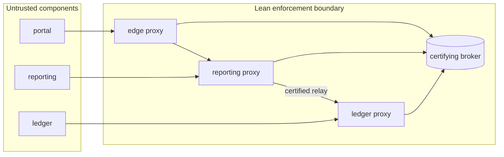

<p align="center"></p>

# Zenturian

**Business rules that survive contact with real systems.**

Zenturian is an open-source enforcement boundary for permissions and disclosure. A central broker
certifies each call; a proxy is the only route between components; responses cross as typed views
carrying only what the recipient may see. Components stay in whatever language they already use. AI
can read the rules, propose the formal policy and explain decisions; Lean checks the enforcement,
and a deployment can be certified against a published theorem.

[Implementation plan](PLAN.md) · [Certification design](docs/theorem.md) ·
[Payroll pilot](docs/zenturian-permissions-and-data-flow-pilot.md) ·
[Run the prototype](examples/payroll/README.md) ·
[Presenter](examples/payroll-presenter/README.md)

## The failures it is built for

Authentication tells you who signed in. Endpoint authorization tells you whether they may call an
operation. Neither tells you which rows the answer contains, or what the recipient can work out
from it.

| Failure | What the checks said | What actually happened |
|---|---|---|
| The extra row | The Bristol manager was authenticated and authorized to open the report. | A missing filter put a Cardiff salary in the Bristol report. |
| The revealing delta | The supplier could read only its own feedback. | “€8,000 above the winning bid” revealed the winning price. |

Both failures live in the data path, between “may call” and “what is returned”. Zenturian moves the
rule to that boundary.

## How it works



1. A component makes a call to **its own proxy** — never to another component. It has no route to
   one.
2. The proxy asks the **broker** for a permit for the exact canonical call: caller, audience,
   subject, tenant, operation, resource and arguments.
3. The broker evaluates the policy and returns a short-lived, single-use **Ed25519-signed permit**
   bound to the call digest and policy hash.
4. The proxy verifies the permit before forwarding. A denied call never reaches the component.
5. The response is checked against the authoritative row scope, projected into a **typed view**, and
   revalidated at commit against the effective facts and policy version.
6. The exchange is written to a hash-chained audit that records decisions and row identities, not
   salaries.

The LeanIn port builds the server directly on
[LeanIn](https://github.com/scidonia/leanin)’s HTTP/1.1 server; LeanIO is not a dependency.

## What makes it different

- **Disintermediation, not a gateway.** The proxy is the only address a component has, including
  component-to-component calls. A compromised component can act only as itself.
- **Permits are certificates, not lookups.** The permit binds the exact call, audience, subject,
  policy version, expiry and nonce; the proxy checks it before forwarding. Replay, stale policy,
  wrong audience and a tampered digest are refused.
- **Disclosure is part of the type.** Responses are views; rows are checked against authoritative
  scope; amounts come from the ledger, not the reporting component’s labels.
- **AI proposes, Lean disposes.** AI extracts rules, generates scenarios and explains decisions;
  Lean validates the policy and enforcement; a human promotes the version. No model runs on the
  request path.
- **A certifiable deployment boundary.** [`docs/theorem.md`](docs/theorem.md) fixes what is proved,
  the trusted computing base, and what is not: the running binaries, OS, crypto and policy fidelity
  are named, not hand-waved.
- **Any component language.** The boundary is the wire seam — `POST /v1/call`, `zcanon.v1`, signed
  permits, policy-by-hash, typed views — so JavaScript, Python and Rust components share one
  discipline.

## See the boundary run

The JavaScript pilot on `main` is an executable model of the design; it runs the payroll fixture and
the behaviour checks.

```bash
node examples/payroll/src/demo.mjs
node --test tests/payroll/*.test.mjs
```

| Act | What the boundary does |
|---|---|
| Alice, the Bristol manager, opens the report | exactly E101/£3,100 and E102/£2,850, `no-store` |
| Nora (preparer), Cara (Cardiff), the South manager open it | refused, zero salary rows |
| The reporting component tries the ledger directly | refused; the ledger is never invoked |
| A mixed snapshot carries Cardiff L3 | the whole release is refused before a byte is sent |
| Bristol management changes mid-open | Alice’s pending release is refused; Ben gets the two rows |
| The owner promotes v2 for an active acting manager | Dana moves from refusal to the same two rows; expiry refuses again |

The pilot is deliberately a model, not the final security boundary. The LeanIn port is in progress:
the broker, proxies and edge are being rebuilt on LeanIn’s HTTP server, with the JavaScript pilot as
the conformance oracle. The canonical vectors, permit format and component protocol are the seam;
the components do not change.

## Status and limits

| Piece | State |
|---|---|
| Payroll pilot (JavaScript) | runnable; 28 checks green |
| LeanIn broker, proxies and edge | in progress |
| Formal theorem (`docs/theorem.md`) | specified; proofs not yet mechanised |
| Policy appraisal and visualisation | designed; AI-assisted workflow specified |

The formal guarantee is scoped: it covers a certified deployment of verified templates and trusted
proxies, under the named assumptions (Lean kernel/compiler, libsodium, LeanIn/runtime, OS isolation,
key custody, clocks and fact sources). It does not prove the running binaries refine the model, that
the policy matches the business rule, or that a recipient forgets what it received. The README is
not a certificate; [`docs/theorem.md`](docs/theorem.md) is where the claim and its exclusions live.

## Design documents

- [PLAN.md](PLAN.md) — architecture, protocol, milestones and verification plan.
- [docs/theorem.md](docs/theorem.md) — what is proved, the trusted computing base, the certifier.
- [docs/zenturian-permissions-and-data-flow-pilot.md](docs/zenturian-permissions-and-data-flow-pilot.md)
  — the payroll pilot.
- [examples/payroll/README.md](examples/payroll/README.md) — run the prototype, its limits and the
  Lean seam.

## License

Apache-2.0; copyright 2026 Scidonia Limited. See [LICENSE](LICENSE) and [NOTICE](NOTICE).
