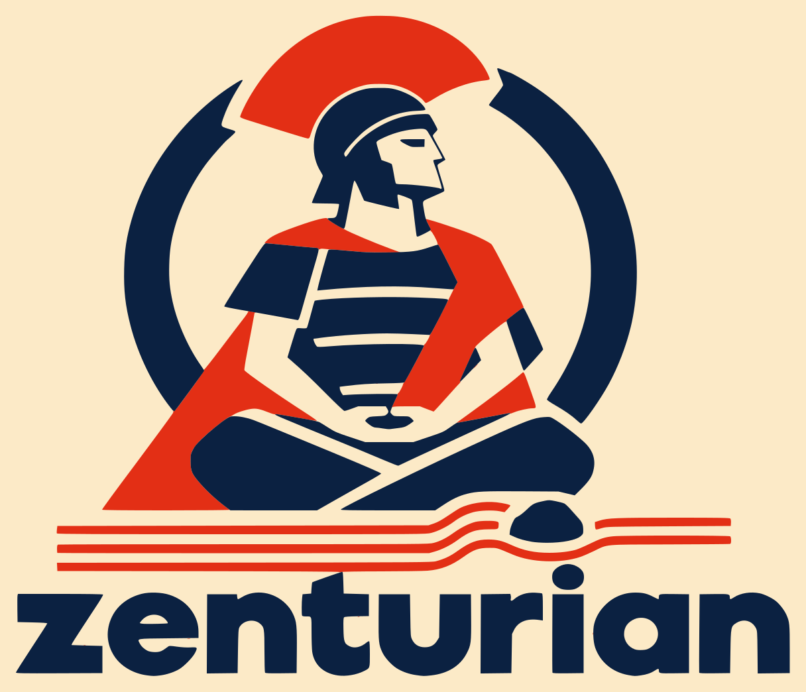

# Zenturian

A certifying permission broker and a set of Lean proxies for enforcing business rules across
components written in any language.

Status: planning. [PLAN.md](PLAN.md) is the implementation plan,
[docs/theorem.md](docs/theorem.md) the certification design, and
[docs/zenturian-permissions-and-data-flow-pilot.md](docs/zenturian-permissions-and-data-flow-pilot.md)
the first client pilot. A JavaScript prototype of that pilot exists under
[examples/payroll/](examples/payroll/); the Lean system still has no build, and the commands in
the plan are the target interface created by milestone M0. To work through the payroll scenarios
yourself, run the presenter in [examples/payroll-presenter/](examples/payroll-presenter/) and open
the page it prints.

## Design in one paragraph

Every component talks only to its own Lean proxy. The proxy obtains a single-use, digest-bound
permit from the central broker, verifies it, and forwards the call. Responses cross back as typed
views with authoritative row scopes and disclosure checks, so a component can neither receive a row
it is not entitled to nor receive a value from which a protected value is reconstructible. AI
appraises natural-language business rules into a formal, checkable policy and explains decisions;
it cannot mint a policy version or a permit.

## License

Apache-2.0. See [LICENSE](LICENSE) and [NOTICE](NOTICE).
