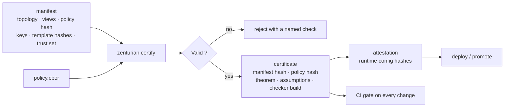

# Certification and theorem design

Status: design. No proofs mechanised yet. This document fixes the claim, the model, the
certifier, the trusted computing base, and the go/no-go gate. It is the companion to
[PLAN.md](../PLAN.md): the plan describes the system; this describes what can be proved about
it and what cannot.

The short version: the provable object is a **certified deployment of verified templates** —
proxies and broker instantiated from a verified Lean template, described by a manifest, policy,
topology and key set. It is not a proof that the running LeanIO binaries, the OS, the crypto
library, or an arbitrary component are correct. Every later claim is relative to that boundary.

The payroll release pilot is the first instantiation:
[zenturian-permissions-and-data-flow-pilot.md](zenturian-permissions-and-data-flow-pilot.md). It
adds the commit-time revalidation in §5.1 and the fact-snapshot assumptions in §7.

---

## 1. Claim and non-claims

| Claim | Status | Object |
|---|---|---|
| Permit verification, policy decision, canonical binding, view projection, session step | Provable now | Pure Lean functions |
| Global safety for N proxies + broker against arbitrary components and network | Provable with a trace model | Deployment of verified templates, trusted proxy set |
| LeanIO/LeanIn/OS/FFI implement the model | Not proved; tested | Thin trusted shell + trace conformance |
| Policy matches the business rule | Not proved | AI appraisal + human promotion |
| Components forget, or do not leak, what they received | Not claimed | Outside the boundary |
| Liveness / availability under failures | Not in the safety theorem | Operational SLOs; separate completeness result optional |

Authentication is necessary but not sufficient. It establishes **origin**; the monitor invariant
establishes **authorisation**. The protocol exists to make the monitor's premises true at the
callee, not to replace the monitor.

---

## 2. Deployment model

```lean
-- Shape, not compiled. The concrete encoding is P0's first task.
inductive Role where
  | broker
  | proxy (component : ComponentId)
  | edge

structure Deployment where
  Node        : Type
  instFintype : Fintype Node
  instDecEq   : DecidableEq Node
  role        : Node → Role
  link        : Node → Node → Bool      -- permitted relay edges
  policy      : Policy
  views       : Node → ViewTable
  keys        : Node → PubKey
  trust       : Node → Bool             -- proxies assumed uncorrupted
  templates   : Node → TemplateHash
```

`State` carries the policy hash, issued permits, per-node local state (session phase, nonce
cache, sequence counters), fact versions and snapshots, in-flight messages, forwarded calls,
deliveries, component knowledge, and the audit log.

`Step` is the protocol's labelled transition relation. Components are the adversary:
`componentSend` may emit any message. The network may `drop`, `delay` and reorder, and may
`inject` only messages that pass authentication. Trusted proxies and the broker follow their
role programs. A `compromise` transition moves a node to adversary control and is excluded from
the safety theorem's trust set; it is analysed separately in §9.

```lean
inductive Step (d : Deployment) : State d → Event → State d → Prop
  | componentSend  ...   -- arbitrary component behaviour
  | proxyRecv      ...   -- only on an authenticated channel
  | proxyDecide    ...
  | brokerIssue    ...   -- only from `decide`, signed
  | proxyForward   ...   -- only with a verified permit
  | proxyRespond   ...   -- only through a view and its invariants
  | deliver        ...
  | adversaryDrop  ...
  | adversaryInject ...  -- fails unless authentic

def Step' (d : Deployment) : State d → State d → Prop :=
  fun a b => ∃ e, Step d a e b

def Reachable (d : Deployment) (s : State d) : Prop :=
  Relation.ReflTransGen (Step' d) (initial d) s
```

Components are not modelled as correct; the theorem quantifies over every trace, including
arbitrary component behaviour. This is a reference-monitor theorem, not a whole-program
correctness theorem.

---

## 3. Invariant and theorem

```lean
def Inv (d : Deployment) (s : State d) : Prop :=
  (∀ f ∈ s.forwarded, Authorized d.policy f.call) ∧
  (∀ v ∈ s.delivered, Disclosable d.policy v) ∧
  (∀ a ∈ s.audit, Logged a) ∧
  NoAmplification s ∧
  TenantIsolation s ∧
  (∀ p, d.trust p → MonitorLocal d p s)

theorem deployment_safety (d : Deployment) (h : Valid d) :
    ∀ s, Reachable d s → Inv d s := ...
```

`Valid d` is a finite, decidable manifest check (§6). The proof is an induction over the trace:

1. **Initial state.** Empty logs, no permits, no deliveries; trivial.
2. **Local monitor.** A trusted proxy forwards only after verifying the permit, the policy hash,
   the audience, the call digest, the context, expiry and nonce; `monitor_sound` gives
   `Authorized` for every forward.
3. **Broker.** `decide_allow_sound` gives `Allows` for every issued permit; the signature binds
   the body; `canonical_injective` binds the call.
4. **Relay.** At an egress, the derived context is attenuated; `relay_attenuates` gives
   `rights(derived) ⊆ rights(human) ∩ rights(caller)` and the callee re-verifies. No
   amplification.
5. **Disclosure.** The projector only constructs declared views; `disclosure_sound` gives
   `Disclosable` for every delivery, and the closure check refuses reconstructible secrets on
   the declared fragment.
6. **Audit.** A proxy may not forward unless the audit append succeeded; `Logged` is preserved.
7. **Adversary steps.** Component sends and network drops/reorders change no invariant;
   injections fail authentication.

`Disclosable` is evaluated at the release commit, not at the decision or the socket write; §5.1
makes the commit revalidation explicit.

Safety is the target. Completeness (“an authorised call can obtain a permit”) is a separate
theorem with fairness assumptions and is not part of v1's claim. Full noninterference is not
claimed; disclosure is a per-delivery label invariant plus the declared-fact closure, because
the system deliberately declassifies some information.

The theorem is **per policy version and per manifest**. A policy change is a new hash, a new
manifest, a new certificate. Permits for the old version expire; the proxy refuses an unknown
hash.

---

## 4. Local proof obligations

These are the proof units. They are also the only parts that may be assumed by the global
theorem, so their statements are fixed before implementation.

| Obligation | Statement |
|---|---|
| `check_sound` | `check p d = true → Derives p d.root` |
| `decide_allow_sound` | `decide p call now = .allow d → Allows p call` |
| `decide_deny_sound` | `decide p call now = .deny r → ¬ Allows p call`, on the complete fragment |
| `canonical_injective` | distinct calls have distinct canonical bytes |
| `permit_binds_call` | a verified permit's digest/context/audience equal the forwarded call's |
| `monitor_sound` | a trusted proxy's forward implies a verified permit and a permitted sequence |
| `view_sound` | a delivered view contains only declared fields and satisfies its row invariants |
| `disclosure_sound` | an accepted disclosure does not put a protected value in the declared closure |
| `relay_attenuates` | the derived label is no greater than the human's and the caller's grants |
| `audit_complete` | every forward and every issued permit has a log entry |

`monitor_sound` is the bridge between the pure checker and the per-hop protocol. The LeanIO
handler around it is the trusted shell; it is not proved, and it is kept small for that reason.

---

## 5. Protocol and authentication

The permit is the end-to-end authorisation object; the channel is transport authentication.
Both are required.

| Property | Mechanism | Premise used by the theorem |
|---|---|---|
| Proxy/broker identity | mTLS or Unix peer credentials | `Authentic` on receipt |
| Component identity | per-component token or Unix peer credentials | `Authentic` on the component channel |
| Broker authority | Ed25519 signature over the canonical permit body | Signature unforgeability |
| Exact call | Canonical digest of subject, audience, target, args, context | `canonical_injective` |
| No cross-audience use | `audience` is the callee proxy/component | Permit check |
| No principal confusion | `subject` and `onBehalfOf` are signed and checked | Permit check |
| No replay | Nonce + session epoch + expiry; cache TTL ≥ permit TTL | Nonce uniqueness |
| No downgrade | `policyHash` is current or in a bounded grace set | Policy-version check |
| No amplification | Egress obtains a permit for the derived context; ingress re-verifies | `relay_attenuates` |
| Fail closed | Broker, audit or policy unavailable → refuse | Monitor step |

The permit body is exactly the one in PLAN §3.2: policy hash, call digest, subject, component,
on-behalf-of, tenant, issued/expires, nonce, derivation, signature. The proxy's check order is
signature → expiry/nonce → policy fetch by signed hash → digest/context → derivation →
session. The order matters: never fetch policy bytes named by an unauthenticated permit.

Channel authentication prevents an unauthenticated local process from injecting a valid-looking
message or racing the broker's port. It does not replace the permit signature: a compromised
proxy can talk on the channel, but cannot mint a permit for another proxy.

### 5.1 Release-time revalidation

A permit authorises a call, not a commit. For a disclosure-sensitive release, the delivery step is
a serialized commit that revalidates the authenticated recipient, the effective facts and the
policy version, and refuses if any changed. The payroll pilot's coordinator orders directory
updates, policy promotion and release commits in one state transition; an asynchronous directory
needs a declared freshness bound, which becomes an additional `Valid` check.

Without this step the invariant is about the decision snapshot, not the delivered view. The
per-call permit remains necessary; it is not sufficient for release.

---

## 6. The certifier

The plug-in is a **static deployment certifier**, not a runtime monitor and not a code verifier.



Inputs:

- `manifest.json`: components, their proxy, relay edges, views, expected template hashes,
  pinned broker keys, trust set, TTLs, clock-skew bound.
- `policy.cbor`: the canonical policy value.

Finite checks (`Valid`):

1. every component has exactly one proxy; every proxy serves exactly one component, except the
   edge;
2. every relay edge is permitted by the policy and attenuates;
3. every operation has a declared view and response invariants;
4. every view's fields and closure are accepted by the policy validator;
5. the policy is stratified and well-formed; the disclosure fragment is declared;
6. keys are pinned; template hashes match the certified template;
7. nonce cache TTL ≥ permit TTL; clock-skew bound is declared;
8. the trust set contains the broker and the proxies serving trusted components;
9. names, tenants and operation identifiers are unique where required;
10. every disclosure path has a serialized release coordinator that revalidates recipient, facts
    and policy at commit; an asynchronous fact source declares its freshness bound.

Output: a certificate containing the manifest hash, policy hash, theorem name, assumption list,
checker build hash, and the check results; the deployer signs the manifest and the certificate.
It is **reproducible**: anyone re-runs `zenturian certify check manifest.json policy.cbor` from
source and obtains the same result. No proof term is serialised; the theorem is compiled into the
certifier, and the finite checks are re-executed by the verifier. This avoids a proof-object format
and keeps the certificate auditable.

The certificate is about a manifest, not about a running process. Attestation binds the two:
each proxy reports its template hash, manifest hash and config hash at startup; the broker logs
the report; the audit chain carries it. A certificate without a matching attestation is treated
as evidence about a document, not about the deployment.

Reproducibility depends on the pinned build in PLAN §11.3; until the Lake dependency gap is
closed, the certifier build hash is recorded and audited.

The certifier never calls an LLM. Policy drafting is offline AI work; certification is a
deterministic Lean program. A policy or topology change re-runs certification and blocks
promotion on failure.

Only instances of the **verified template** are certifiable. A hand-written proxy must either be
replaced by the template or supply a refinement proof against the same local contract; the
certifier rejects an unknown template hash rather than assuming it correct.

---

## 7. Trusted computing base and assumptions

| Component | Trust | Why |
|---|---|---|
| Lean kernel and compiler | Trusted | Standard proof-assistant assumption |
| libsodium (Ed25519, SHA-256) | Trusted; idealised in proofs | No computational crypto proof in scope |
| LeanIO / LeanIn HTTP and runtime | Trusted shell; conformance-tested | Not verified; keep the shell thin |
| OS isolation (UIDs, nftables, cgroups) | Trusted; tested | Topology is not a Lean theorem |
| Broker signing key, TLS/peer credentials | Trusted custody | Compromise is total |
| Clock | Bounded skew assumed | Expiry and replay reasoning |
| Authoritative fact sources (directory, ledger) | Trusted for the facts they own; freshness is a client dependency | The theorem is relative to the fact snapshot |
| Policy source and appraisal | Not proved | AI proposes; human promotes |

Named assumptions:

1. SHA-256 is collision-resistant.
2. Ed25519 signatures are unforgeable without the private key.
3. A component cannot bypass its proxy (OS isolation holds).
4. The audit log is append-only and its storage is not tampered with.
5. Clocks stay within the declared skew bound.
6. The deployed processes match the attested manifest.
7. The policy value expresses the intended rule; this is a human/AI judgement, not a theorem.
8. A component may retain and later disclose what it legitimately received.
9. The edge verifies the front door's assertion and uses the asserted principal as the call
   subject; identity is only as good as that channel.
10. **Facts.** Directory and ledger facts are correct for the snapshot used; the release
    coordinator serialises fact updates, policy promotion and release commits, or the source
    declares a freshness bound.

Assumptions 1–3 support the permit theorem; 4–6, 9–10 support the global invariant and certificate;
7–8 bound the business claim. They are listed in every certificate.

---

## 8. What the theorem does not cover

- The running binaries refine the model. Conformance tests can falsify a deviation; they cannot
  prove its absence.
- A compromised proxy can bypass its own monitor for its own component. The safety theorem is
  scoped to trusted proxies; §9 states the blast radius.
- A compromised broker or signing key is total.
- A component can encode a secret in an allowed free-text field, or retain data and leak it
  later. Views, bounds and field policy reduce the channel; they do not close it.
- Side channels, traffic analysis, and timing leaks are not modelled.
- Liveness, availability, and denial of service are not safety properties.
- Correctness of authoritative directory and ledger facts. A lying source defeats the release
  theorem, which is relative to the snapshot it supplies.
- Policy fidelity: a correct enforcement of the wrong rule is still the wrong rule.

---

## 9. Compromise and blast radius

| Compromised node | Consequence | Residual claim |
|---|---|---|
| Component | Acts only through its proxy; can retain/leak its own view | Boundary holds for that component; no new authority |
| Proxy | Can skip its own monitor for its component; cannot mint permits for another proxy | Other proxies verify independently; broker log records issued permits; no cross-proxy forgery |
| Broker / signing key | Can mint any permit | Total authorisation compromise; recorded assumption |
| Audit storage | Can hide evidence | Detection by hash-chain verification; anchoring is future work |
| Host root | Defeats UID/firewall isolation | Out of scope; stated |

A blast-radius theorem is a separate, optional result. The safety theorem's trust set is
explicit, and a certificate names the components it covers.

---

## 10. Falsifiers and model risks

The theorem is worthless if any of these is true; each has a check or a stated limit.

| Risk | Detection |
|---|---|
| The proxy shell can forward without calling the monitor | Code review, fuzzing, trace conformance |
| The manifest does not match the deployment | Signed manifest + startup attestation |
| The policy compiler accepts a different rule than the source | Appraisal review, scenarios, diff |
| Nonce cache is smaller than permit TTL | `Valid` check |
| Clocks drift beyond the bound | Monitoring, NTP, skew check |
| The model omits a real message/state (streaming, partial failure) | Conformance traces, model review |
| A view leaks through an undeclared field | `view_sound`, disclosure tests, review |
| A relay constructs a broader context | `relay_attenuates`, hostile test |
| A trusted proxy is compromised | Trust-set scope; incident procedure |
| The certifier itself is wrong | Small kernel, proof regression, independent re-run |

---

## 11. Plan integration and gate

This is a first-class track, not a side quest.

| Phase | Deliverable | Gate |
|---|---|---|
| P0 | 2 proxies + broker + one policy; toy `deployment_safety`; measured proof effort | 2–3 week timebox; go/no-go before M1 |
| P1 | `check_sound`, `decide_sound`, canonical, permit binding, session, view | M1 proof core, no `sorry` |
| P2 | Protocol trace model, relay, disclosure, audit; payroll instantiation | M2–M4 |
| P3 | Trace logging and replay/conformance; hostile component suite | M3–M5 |
| P4 | Manifest schema, `Valid` checks, `zenturian certify`, CI gate | M5–M7 |
| P5 | Published theorem, assumptions, TCB, external review | M9 |

If P0 fails, the plan falls back to local monitor proofs plus conformance testing. The global
claim is withdrawn, not quietly weakened. The certifier is not shipped with an overstated
certificate.

P0's success criteria:

- the trace model is small enough to review;
- the trusted shell boundary is explicit in code;
- the toy theorem compiles without `sorry` and uses only the named assumptions;
- the proof structure scales to relay and views without re-modeling;
- the certifier can reject a manifest with a named failing check.

---

## 12. Open decisions

| Decision | Options | Recommendation |
|---|---|---|
| Trust-set semantics | all-or-nothing vs per-proxy | per-proxy; certificate names covered components |
| Certificate form | signed manifest + reproducible report vs serialised proof | signed manifest; re-run from source |
| Channel authentication | mTLS vs UDS peer creds vs tokens | mTLS/UDS where available; tokens as the v1 fallback |
| Liveness in scope | safety only vs safety + completeness | safety in v1; completeness separate |
| Crypto treatment | idealised vs computational | idealised; name the assumptions |
| Model-checking spike | TLA+/Alloy vs Lean only | optional TLA+ for protocol shape; Lean for the theorem |
| Attestation | config hashes vs TPM | config hashes first; TPM later |
| Release consistency | serialized coordinator vs freshness bound | serialized coordinator for the pilot; declared freshness bound for asynchronous sources |
| Policy certification unit | per version+manifest | per version+manifest; re-certify on change |

---

## 13. One-sentence claim

For every reachable trace of a deployment whose proxies and broker are instances of the verified
template, whose manifest satisfies `Valid`, and whose trusted set is as declared, every
forwarded call is authorised by the pinned policy, every delivered value is within its declared
view and closure at a release commit that revalidated the recipient, the effective facts and the
policy version, and every permit and forward is in the audit chain — under the assumptions in
§7, and with the exclusions in §8.
